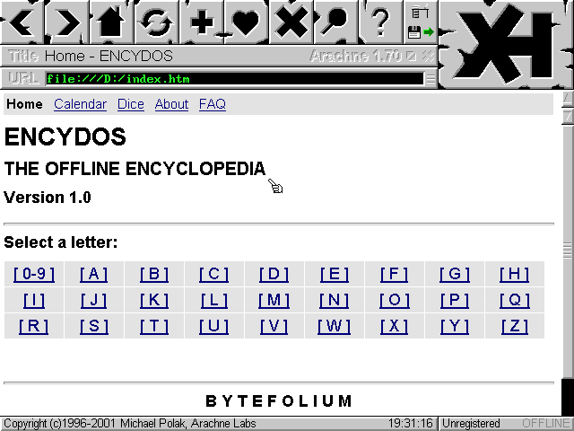
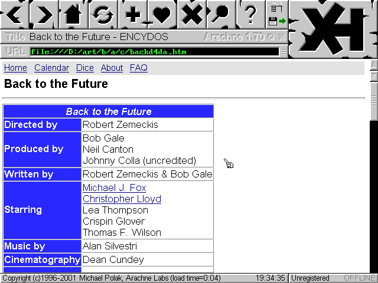
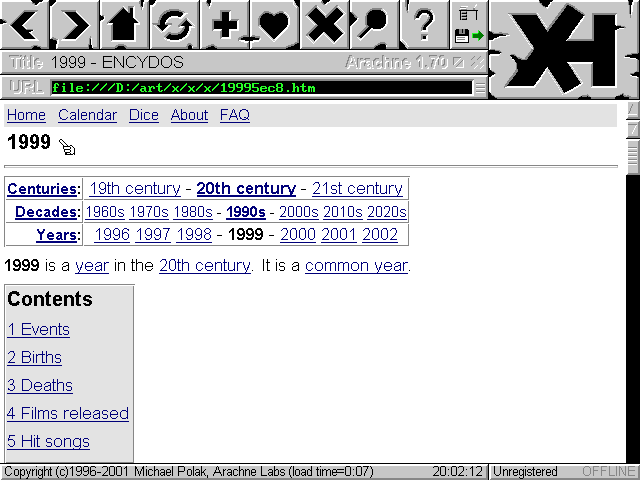

# ENCYDOS: The Offline Encyclopedia (v1.0)

**Published by [ByteFolium](https://archive.org/details/@bytefolium)**

## What is ENCYDOS?
ENCYDOS is a static, offline preservation of the Simple English Wikipedia, capturing a snapshot from June 2008. It contains approximately 43,000 articles and is designed to run natively on MS-DOS and 16-bit hardware.

**Note:** This GitHub repository contains the **source code** and **sample outputs**. To download the ready-to-run CD-ROM ISO (approx. 275 MB), visit the [Archive.org page](https://archive.org/details/encydos-2008/).

## Screenshots

**Home Page (A-Z Index)**

**Article View (Complex Infoboxes & TOC)**

## Project Goals & Constraints
*   **The Challenge:** "Can it run Doom?" tests a 3D renderer. "Can it read ENCYDOS?" tests text parsing, hyperlinks, and data structures.
*   **Sustainability:** Proving that a 15-watt, thrift-store PC can still access a 43,000-page reference library completely offline.
*   **Preservation:** Retaining the exact 2008 text and internal link structure while stripping modern CSS, JavaScript, and unrenderable images.

## AI Disclosure
This project is an AI-assisted collaboration. The Python pipeline, HTML sanitization logic, and layout debugging were developed by a solo developer using an AI model as a pair-programmer to parse 2008 HTML anomalies for DOS compatibility. The strict constraints of Arachne 1.70 dictated the final output.

## Building from Source
To rebuild ENCYDOS yourself, see [BUILD.md](BUILD.md).

The script expects the **June 2008 static HTML dump** of the Simple English Wikipedia. You can download the exact source data from Wikimedia here:
[https://dumps.wikimedia.org/other/static_html_dumps/2008-06/simple/](https://dumps.wikimedia.org/other/static_html_dumps/2008-06/simple/)

Extract the dump so your folder structure looks like this:
`./simple/articles/...`

## License
*   **The Python Code:** Released under the 0BSD License (Public Domain).
*   **The Wikipedia Text:** GFDL / CC BY-SA 3.0.

---
*An encyclopedia shouldn't need a modern computer to remain useful.*
